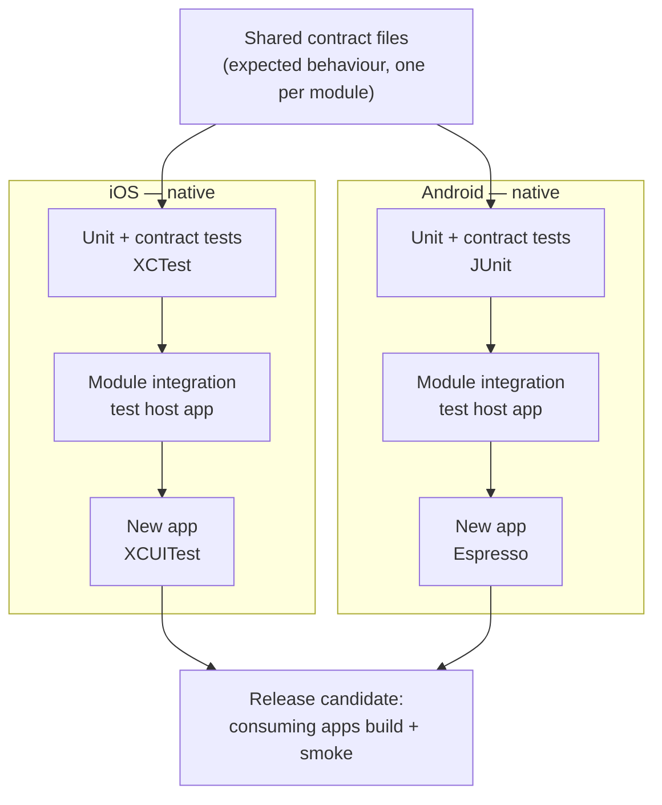
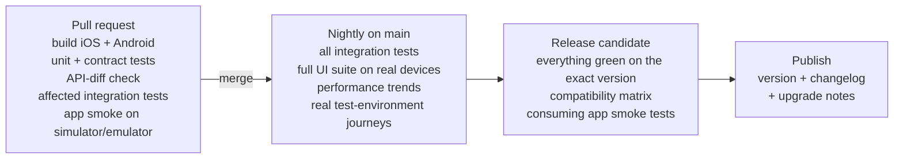

# Mobile SDK quality approach

**Goal:** fast, trustworthy feedback for every SDK change on iOS and Android, so that consuming apps can upgrade safely, without relying on a large, slow end-to-end suite.

**Main idea:** catch each type of problem at the lowest and fastest level that can catch it. End-to-end tests are a thin top layer that checks the wiring, not the main safety net.

**Starting assumptions** (the assignment does not specify these; see [questions for the team](questions-for-the-team.md)):

- SDK modules are native: Swift on iOS, Kotlin on Android. Each module has a version number, and consuming apps choose which version to use.
- The code is on GitHub and CI is GitHub Actions. The same ideas work in any CI.
- A device cloud (BrowserStack or Firebase Test Lab) is available or can be added.
- Some automation already exists. I would reuse what works before building anything new.

---

## 1. Test strategy

### Test layers

| Layer | What it catches | iOS | Android | When it runs | Owner |
| --- | --- | --- | --- | --- | --- |
| **1. Module unit tests** | Logic bugs inside one module | XCTest | JUnit | Every PR (minutes) | Developers. QA makes sure they run in the PR gate but does not write them. |
| **2. Contract tests** | A change in a module's public behaviour or API; iOS/Android differences | XCTest against a shared contract file; API-diff check | JUnit against the same contract file; API-diff check | Every PR (minutes) | QA and module developers. Consuming teams review the contract. |
| **3. Module integration tests** | Two real modules interfering: shared state, initialisation order, threading | XCTest in a small test host app, simulator | Instrumented tests in a test host app, emulator | PR if the module or its dependencies change; all of them nightly | Platform team and QA |
| **4. New app tests** | Wiring of modules into the app, navigation, app lifecycle, key user journeys | XCUITest | Espresso | A few smoke tests per PR; full set nightly on real devices | App team and QA |
| **5. Consuming app checks** | An app fails to build, start or complete a key journey with the new SDK version | Build + smoke test with the release candidate | Same | Each SDK release candidate | Consuming teams, supported by the platform team |



Most tests sit in layers 1–3. They are fast, stable and point straight to the module that broke. Layers 4–5 have few tests: they prove the parts work together for a user. They are not the place to find logic bugs.

**Test host app.** Layers 3–4 need a small app that exists only to load real modules and host the tests. On one of my previous projects, the Android SDK had exactly this: a separate harness app that depends on the SDK and hosts the Espresso suite.

**Backend in tests.** Layers 1–2 use fakes in code. Layers 3–4 use a stub server, for example WireMock, so results do not depend on test-environment data or availability. A small set of journeys runs nightly against the real test environment to catch real API changes.

### Native or cross-platform?

**Native tests (XCTest/XCUITest, JUnit/Espresso)** for all layers:

- They run inside the app or module process, so they are fast and much less flaky than black-box UI automation.
- They are written in the same language as the SDK, so developers can read, run and fix them.
- They can see platform-specific behaviour, such as Keychain vs Keystore or threading differences. Those differences are exactly where iOS and Android drift apart.

**What is shared across platforms is the expected behaviour, not the test code.** Each module keeps a contract file: scenarios with inputs and expected results. Both native suites read it (see the [automation example](../example/README.md)). When the contract changes, both platforms fail until both are updated.

**Cross-platform UI tools (Appium)** only for a handful of identical journeys on real devices, and only if the team already has them. On one of my previous projects I moved an Android suite from Appium to Espresso for exactly these reasons: speed, stability and developer ownership.

### What stays exploratory

- The first integration of a new module into the app, before we know which risks deserve automation.
- New iOS and Android OS versions and betas, and unusual devices.
- Interruptions and real-world conditions: backgrounding during login, calls, poor network (Network Link Conditioner, Charles/Proxyman throttling), low storage.
- Accessibility with VoiceOver and TalkBack, and dynamic font sizes.
- Security edge cases: what is visible in the app switcher, tokens in logs, login state after reinstall (on iOS the Keychain survives app deletion), deep links that skip login. Basic session rules (token saved only after login, deleted on logout, session expiry) are automated, not exploratory.

Every important finding becomes an automated test at the lowest layer that can reproduce it.

### Keeping feedback fast and maintainable

- **Only run what is affected on a PR.** A simple module dependency map plus GitHub Actions path filters: a change in `auth` runs auth tests and the integration tests of modules that depend on auth. Everything runs nightly anyway, to catch what the map misses.
- **No sleeps and no shared test accounts.** Use fakes, stub servers and test IDs (`accessibilityIdentifier` / resource IDs) for UI elements.
- **Every test has an owner** (GitHub `CODEOWNERS`), and every flaky test has a ticket.
- **Watch test health:** duration and flaky rate per suite. A test nobody trusts is removed or fixed, not ignored.
- **Non-functional basics nightly:** SDK initialisation time, app start time and memory (XCTest metrics, Android Macrobenchmark), compared with the previous release. At first this is a trend to watch, not a blocking gate.

---

## 2. Automation example: authentication

The full example, with run instructions, is in [example/](../example/README.md).

This is a layer 2 contract test.

- One contract file, [auth-contract.json](../example/contract/auth-contract.json), describes what the login function of the authentication module must return:
  - correct login → `success`
  - empty password → `invalidInput`, rejected in the app **without calling the server**
  - wrong password → `invalidCredentials`, rejected by the server (401)
  - service down → `serviceUnavailable` (503)
- One XCTest test (iOS) and one JUnit test (Android) read **the same file** and check their own platform's implementation against it.
- The login server is a fake, so the tests run in seconds with no backend or device. They run on every PR via GitHub Actions.

```text
for each case in auth-contract.json:
    server = FakeServer(answers with case.serverStatus)
    result = AuthClient(server).login(case.username, case.password)
    assert result           == case.expected.result
    assert server.wasCalled == case.expected.serverCalled
```

**Why authentication:** every consuming app depends on it, and mistakes are immediately visible to customers. The example also shows the difference between checks done in the app and checks done by the server.

**Out of scope for this layer, covered elsewhere:** the real backend (layer 3, via a stub server), login used by other modules (layer 3), and the login UI (layer 4 plus exploratory testing).

---

## 3. CI/CD and release validation

The pipeline stages and a GitHub Actions sketch are in [ci-pipeline.md](ci-pipeline.md).



### Quality gates

| Gate | Blocks | Must be true |
| --- | --- | --- |
| **Pull request** | Merge | Both platforms build. Unit, contract and affected integration tests pass. The API-diff check finds no breaking change, or the version number is raised to a new major version and consumers are told. |
| **Nightly** | Nothing automatically, but a red nightly must be explained before the next release | Failures are triaged by the next working day and routed to the owning team. |
| **Release candidate** | Release | Everything required is green on this exact version, on both platforms. The compatibility matrix rows pass. No open critical bugs. Changelog and upgrade notes are written. |

**API-diff check:** a tool compares the public API of the module with the last released version and lists breaking changes. On iOS: `swift package diagnose-api-breaking-changes`. On Android: the Kotlin binary-compatibility-validator plugin. A cheap and very effective check for "module updates affecting consumers". On one of my previous projects we used a simpler version: a GitHub Actions check failed a PR that changed public interface files unless the author marked the change as breaking or confirmed it was not. It did not detect breaks automatically, but it made every author think about consumers.

### Slow and unstable tests

- **Slow tests** move from PR to nightly. They still count for the release gate. Real-device minutes also cost money: on one of my previous projects, real-device UI runs were opt-in on a PR (via a label) and ran automatically after merge.
- **Check the environment before spending device time.** A quick pre-flight step checks that the test environment and test data are available. If it fails, the run is reported in seconds as an environment problem, instead of 20 minutes of failed product tests. We ran this check before every real-device run on that same project.
- **Time limits per test** (an idle timeout on the device cloud, a job timeout in CI), so one hung test cannot use up the whole run.
- **One automatic retry at most** (`xcodebuild -retry-tests-on-failure`, Gradle test-retry plugin). A test that passes on retry is reported as **flaky**, not as green, and gets a ticket.
- **Quarantine** takes a flaky test out of the PR gate so it does not block unrelated work. Each quarantined test has an owner, a ticket and a deadline, and the quarantine list is visible on the dashboard. A test that protects a critical flow (login, payments) is quarantined only if another test covers the same risk.
- **Track the flaky rate** per suite and fix the worst offenders first. Raising timeouts and adding sleeps are not fixes.

### How failures are communicated

- **PR:** a GitHub check status plus a short comment: which test failed, on which platform, module versions, and a link to logs, screenshots or video (`.xcresult` / test reports). `CODEOWNERS` notifies the right team. The comment is updated on each push instead of adding a new one, and the CI job summary lists pass/fail per device and every failing test. I have used this reporting setup before and it worked well.
- **Nightly:** a summary message in the team channel (Teams or Slack): what failed, whether it is new or known, and who owns it.
- **Release:** a short release report listing the version, what was tested, the matrix results, known issues and upgrade notes, shared with consuming teams.

### Compatibility

- **Semantic versioning** for modules and the SDK: PATCH = bug fix, MINOR = new feature that does not break anything, MAJOR = breaking change. The API-diff check enforces this.
- **Supported versions are written down:** for example the current and previous major SDK version, the lowest supported iOS and Android version, and which module versions work together.
- **Compatibility matrix per release candidate** (example):

| What is tested | Tests run | Platforms |
| --- | --- | --- |
| Candidate SDK + new app | Full integration + UI suite | iOS + Android |
| Candidate SDK + each consuming app (current version) | Build + smoke journeys | iOS + Android |
| Upgrade: consuming app moves from previous SDK version to candidate | Builds without code changes (minor/patch); smoke passes | iOS + Android |
| Lowest and latest supported OS | Integration + smoke | Simulator/emulator + real devices |
| Upcoming OS beta | Smoke | Informational, not blocking |

- **iOS and Android parity** is checked by the shared contract files: the same scenarios and expected results on both platforms.
- **Consuming apps adopt safely:** each release has a changelog and upgrade notes, and a consuming app can pin the previous version if something goes wrong.

---

## 4. Investigation scenario

**The situation, as I understand it:** a shared module, which I call **M**, gets a minor update from 3.4 to 3.5. After that, an iOS test that uses M together with another module, **N**, fails now and then. The same combination is fine on Android, both modules pass their own tests, and a rerun is often green. So the problem appears only with the new version, only on iOS, only with both modules, and not every time.

**Contain first.** Do not release M 3.5 to iOS consumers until this is understood; consumers stay on 3.4. Open one ticket with an owner, and keep the first failing run: logs, `.xcresult` bundle, crash logs, device/simulator, Xcode version, exact module versions. "It passed on rerun" does not close the ticket.

**Step 1: Make it reproducible.** Run only the failing test many times on the same machine:
`xcodebuild test -only-testing:<FailingTest> -test-iterations 50 -run-tests-until-failure`.
Count the failures, for example 6 out of 50. That gives a baseline for later comparisons. Do it both locally and on CI.

**Step 2: Narrow it down by comparison.** Same machine, same number of runs each:

| Run | If it fails… |
| --- | --- |
| M 3.4 + N | …the problem existed before 3.5 (look at N, the test or the environment) |
| M 3.5 + N | (the failing case, baseline) |
| M 3.5 alone, N alone | …if each passes alone, the problem is in how they interact |
| M 3.5 + N, test run alone vs. in the full suite | …if it fails only in the suite, another test leaves state behind |
| M 3.5 + N, clean simulator vs. CI machine | …if it fails only on CI, look at the environment (load, Xcode version, simulator state) |

**Step 3: Check the four possible causes.**

| Cause | What I would look at |
| --- | --- |
| **Product (code in M or N)** | Read the 3.5 changelog and diff. Run with **Thread Sanitizer** and Main Thread Checker to find race conditions. Typical iOS-only interactions: both modules use the same Keychain item or UserDefaults key, a shared singleton, the same notification observers, or initialisation order changed in 3.5. |
| **Dependency** | Compare `Package.resolved` / lock files for 3.4 and 3.5. Did 3.5 bring a new version of a shared library, or are two versions of the same library now linked? Pin the old version and rerun. |
| **Test** | Does the test wait with fixed sleeps, assume an order, or share state with other tests? Turn on random test order in the test plan. Check what teardown cleans up. |
| **Environment** | Erase the simulator before each run and compare a slow CI machine with a fast local one. Check whether CI uses a different Xcode or iOS version. A CI image set to "latest Xcode" can break tests with no code change, so the Xcode version should be pinned. |

Android being green is a clue, not proof. The iOS implementation differs (Keychain, threading), so the bug can be real on iOS only.

**Diagnostics to add if needed:** timestamped logs from both modules for the key events (init, callbacks, storage access), with one shared ID per test run. Then the order of events in a failing run can be compared with a passing run.

**Prevent it next time:**

- Add a **regression test at module-integration level with M and N together** in the test host, run on every PR that touches M, N or their shared dependencies.
- Record that M and N interact in the **dependency map**, so the pipeline runs both modules' tests when either changes.
- If a shared resource caused it (a Keychain key, a singleton), add it to the **module contract**: who owns it and how it may be used.
- Share a short write-up with both teams: what happened, how it was found, and what changed.

---

## 5. Initial priorities

**1. Map the current state: modules, dependencies, consumers, existing tests.**

- **Why:** I can't prioritise risks I can't see. Some automation exists, so reusing it is faster than starting over.
- **Information:** list of modules and owners, who depends on whom, which apps consume which versions; existing test suites with their duration, flaky rate and what they cover; recent incidents and escaped bugs.
- **Who:** module leads, platform/CI engineers, one or two consuming-app teams.
- **First outcome (first 2–3 weeks):** a one-page map of modules, dependencies and consumers; a list of existing tests; the top 5 risks.

**2. Agree the test strategy and a PR quality gate, and try it on one critical module.**

- **Why:** without agreed layers and ownership, every team tests differently and nobody owns the gaps between modules.
- **Information:** the module's public API and expected behaviour; which existing tests can become contract tests; current CI setup.
- **Who:** the module team (authentication is a good candidate), platform engineers, consuming-team representatives.
- **First outcome:** a short agreed strategy document (layers, owners, gates), and a working PR gate for one module on both platforms: unit + contract tests + API-diff check, with clear failure messages.

**3. Make release validation and compatibility visible.**

- **Why:** consuming apps need to know that a new SDK version is safe to adopt. That is where regressions currently reach other teams.
- **Information:** how releases are made and versioned today; which consuming apps and versions must be supported; the lowest supported OS versions.
- **Who:** platform/release owner, consuming-app teams, QA.
- **First outcome:** for the next release candidate, a smoke run in one consuming app on iOS and Android, plus a first compatibility matrix and a release report template.

**What I would postpone:** a large new E2E suite, replacing existing tools, full device matrices, and hard numeric targets for coverage, duration and flakiness. Those come after the first measurements.

---

## Assumptions, risks and trade-offs

| Topic | Choice | Trade-off / risk |
| --- | --- | --- |
| Few E2E tests | Confidence comes mostly from unit, contract and integration tests | Some wiring bugs show up only in the full app. Mitigated by nightly UI runs, release smoke and exploratory testing. |
| Shared contract files, native test code | Same expectations on both platforms; each platform tested in its own language | Two test implementations to maintain. They stay small because the scenarios live in data. |
| Run only affected tests on PRs | Fast feedback | The dependency map can be wrong or incomplete. The nightly full run catches what it misses. |
| Fakes and stub servers | Fast, deterministic tests | They can drift from the real backend. Mitigated by a few nightly real-environment journeys. |
| One retry plus quarantine | Unrelated PRs are not blocked by flaky tests | Real intermittent bugs can hide. Mitigated by reporting retries as flaky with a ticket, and never quarantining critical coverage without a replacement. |
| Supported versions written down | Clear promise to consuming apps | Requires agreement and some test-infrastructure cost for older versions. |
| Testability seams (replacing the server with a fake) | Needed for fast module tests | May need small changes in modules that do not have them yet. |
